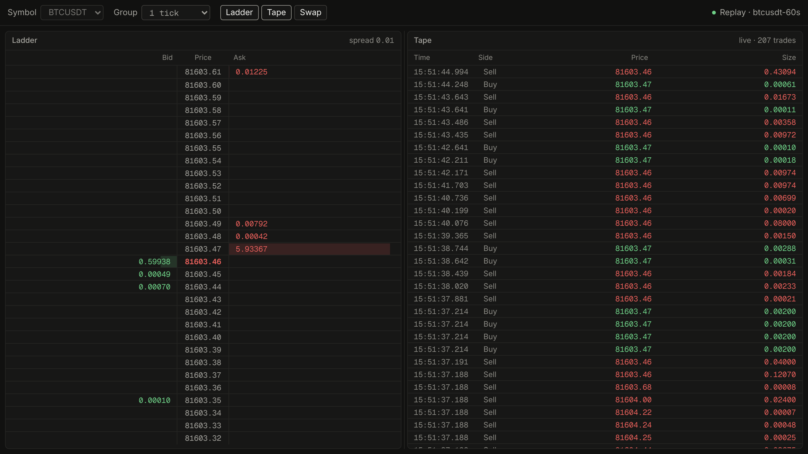
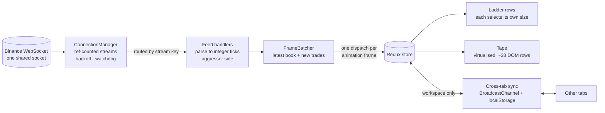

# Orderflow Panel

A live **DOM ladder** and **trade tape** in the browser, fed by Binance's public WebSocket.
It's built to handle a firehose of market data without "Redux churn", stay correct across
browser tabs, and prove every performance claim with a measurement against a deliberately
naive version.

**Live:** _deploying_ · **Replay (works anywhere, no exchange connection):** _deploying_`/?replay=btcusdt-60s`

React 19 · TypeScript · Redux Toolkit · react-window · Vite. No UI or CSS libraries.



## What it shows

- **Ladder (Depth of Market).** A fixed column of prices, with resting buy (bid) sizes on
  the left and sell (ask) sizes on the right. Prices stay still and sizes change, so you
  watch liquidity appear and disappear. Rows can be grouped (1–100 ticks), and the last
  trade is marked in the colour of whoever was aggressive.
- **Tape (time & sales).** Every trade, newest first: time, aggressor side, price, size.
  Large prints (≥ 50k USDT) are emphasised.
- **Workspace.** Symbol, panel visibility and order, ladder grouping and a draggable split.
  It's shared live across tabs and restored on reload.

## The problem

Binance sends a full top-of-book snapshot every 100 ms plus every trade, and a busy
market produces dozens of messages a second without pause. The naive React + Redux
version dispatches once per message and re-renders the whole ladder and every tape row
each time. Under load, the main thread never gets a chance to paint. The measurements
below show it blocked for **28 of every 30 seconds**.

## Architecture



| Path | Responsibility |
|---|---|
| `src/ws/ConnectionManager.ts` | One socket for every stream. Streams are ref-counted, so the first subscriber sends SUBSCRIBE and the last one leaving sends UNSUBSCRIBE after a 250 ms grace. Reconnects with jittered exponential backoff; the retry counter resets only after a stable connection. Rotates through URLs, replaces silent or hung sockets, and coalesces and throttles control frames to Binance's limit. |
| `src/ws/useStream.ts` | Ties a subscription to a component's lifetime: hiding a panel unsubscribes its stream. |
| `src/ws/adapters/binance.ts` | Everything Binance-specific: URLs, frame formats, parsing to integer ticks, aggressor side from the `m` flag. |
| `src/ws/adapters/replay.ts` | Plays a recorded capture through the same manager, as a fake socket. |
| `src/market/frameBatcher.ts` | Buffers between the socket and Redux. Keeps the latest book and appends trades, then dispatches once per animation frame. Bounded while the tab is hidden. |
| `src/market/marketSlice.ts` | Book and trades. Drops frames for a symbol you switched away from, ignores duplicate trade ids, caps the tape at 5,000, clears the book on disconnect. |
| `src/app/store.ts` | One invariant across slices: market data always belongs to the selected symbol, reset in the same dispatch that changes it. |
| `src/market/selectors.ts` | The grouped book, computed once per update (`createSelector`) and shared by every row. |
| `src/features/ladder/` | Fixed price grid that recentres only when the market nears an edge. Rows keyed by price and memoised. Bars use `scaleX` driven by one CSS variable written outside React. Flashes only on significant changes. |
| `src/features/tape/` | react-window list that freezes while you scroll or navigate, with an "N new · back to live" control. |
| `src/workspace/` | Workspace slice with `(rev, origin)` ordering, synchronous rehydration, and BroadcastChannel sync. |
| `src/perf/` | Profilers and a collector used by the measurement harness. |

### Data flow, one message

1. The Ladder mounts and calls `useStream('btcusdt@depth20@100ms')`; the manager opens
   the socket if needed and subscribes.
2. A message arrives and is routed by its stream key. The handler takes the **symbol from
   the stream key**, never from React state, then parses prices into integer ticks
   (`81596.08` becomes `8159608`).
3. The batcher buffers it. At the next animation frame it dispatches **one**
   `frameFlushed`, however many messages arrived.
4. The reducer drops stale-symbol frames and duplicate trades. Every `useSelector` re-runs,
   and only components whose selected value changed re-render: usually a handful of ladder
   rows and the visible tape rows.

### Cross-tab sync and persistence

- **Saved state is read synchronously** from `localStorage` *before* the store is created,
  so the first render is already correct. There's no async rehydrate step to race against.
- **Every change is written synchronously.** A debounced write would lose a change made
  just before a reload.
- **Ordering.** Each local edit bumps `rev` and stamps the tab id. A tab accepts remote
  state only if `(rev, origin)` is newer, so two tabs editing at the same instant converge
  on the same winner, and late or duplicated messages are no-ops.
- **No echo loops.** Remote state is applied with a different action that is never
  re-broadcast.
- **New tabs.** A new tab sends `hello`; peers reply with their state. This covers a write
  that landed after the new tab read storage.
- **Untrusted payloads.** Incoming state is validated, because another tab could be
  running an older build.
- **Split drag.** Dragging updates only a CSS variable; one action on release commits,
  persists and syncs it.

## Performance

**Method.** Measurements use a production build with React's profiler kept on
(`npm run build:profile`) and a **real 60 s BTCUSDT capture**
(`public/captures/btcusdt-60s.json`) replayed identically for every run, in headless
Chromium at **4× CPU throttling** (like DevTools' "4× slowdown", roughly a mid-range
laptop). Each run has a warmup and a 30 s window. The tables show the median of 3 runs.
Three configurations:

- **Baseline** ([`baseline` branch](https://github.com/engineeringwitharavind/orderflow-panel/tree/baseline)):
  same features, no optimisations. One dispatch per message; the ladder body subscribes to
  the whole book and passes sizes to non-memoised rows; bars sized by `width`; every trade
  is a DOM row.
- **Main, batching off** (`?batch=off`): every optimisation except per-frame batching, to
  isolate what batching alone buys.
- **Main:** everything.

PERF_TABLES

Reproduce:

```bash
npm run build:profile && npx vite preview --outDir dist-profile --port 4173
npx playwright install chromium   # first time only
npm run perf -- --label main-1x-r1 --capture btcusdt-60s
node scripts/perf-summary.mjs
```

### Known limits (measured, not guessed)

- **The tape is the remaining hot spot under heavy throttling.** At 4×, the optimised
  build still drops frames in the busy scenario. A Chrome trace attributes the largest cost
  to re-laying-out the ~38 visible tape rows every frame: newest-first means every row's
  text changes on each update. CSS containment was tried and made no measurable
  difference, so it was reverted. Next step: cap the tape's refresh at about 10 Hz (faster
  than anyone reads a tape) or draw it on a canvas. Unthrottled, it holds 60 fps.
- **Depth is the top 20 levels.** The partial-depth stream is authoritative on every
  message, so there's no sequence state to get wrong, but grouping has little to show. Full
  depth needs a REST snapshot plus the diff stream with sequence-gap detection and resync.
- **One socket per tab.** Sharing one connection across tabs (a leader tab chosen with Web
  Locks, then BroadcastChannel) would cut connections.
- **No flash settings.** A trader-facing on/off/threshold setting belongs in the workspace.

## Design

- Semantic colour tokens only; dark by default, light via `prefers-color-scheme`.
- System UI font for labels, Geist Mono (OFL, bundled) with `tabular-nums` for every
  number.
- No layout shift: fixed row heights, fixed column widths, fixed panel headers; bars use
  transforms.
- Flashes are colour only, 180 ms, significant changes only, and off under
  `prefers-reduced-motion`.
- The ladder (`role=grid`) and tape (`role=listbox`) are focusable, with
  `aria-activedescendant` and one visible focus ring.
  - Ladder: ↑/↓ and PageUp/PageDown move; C recentres.
  - Tape: ↑/↓, PageUp/PageDown and End move; Home or Esc returns to live.
- Side is written out ("Buy"/"Sell"), not shown only by colour.

## Run it

```bash
npm ci
npm run dev            # http://localhost:5173
npm test               # 52 unit tests
npm run typecheck
npm run record         # record a new capture: npm run record -- ETHUSDT 120
```

URL options:
- `?replay=btcusdt-60s&speed=10` replays a capture.
- `?batch=off` turns off per-frame batching.

## How it was built

Claude Code wrote the code; I directed it, reviewed every block, and checked it against
live data. [BUILD_LOG.md](BUILD_LOG.md) lists what the AI got wrong and how each problem
was caught.
